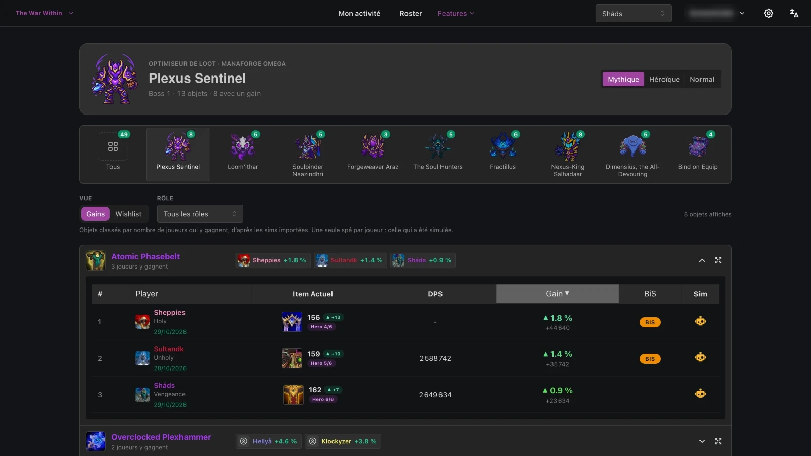
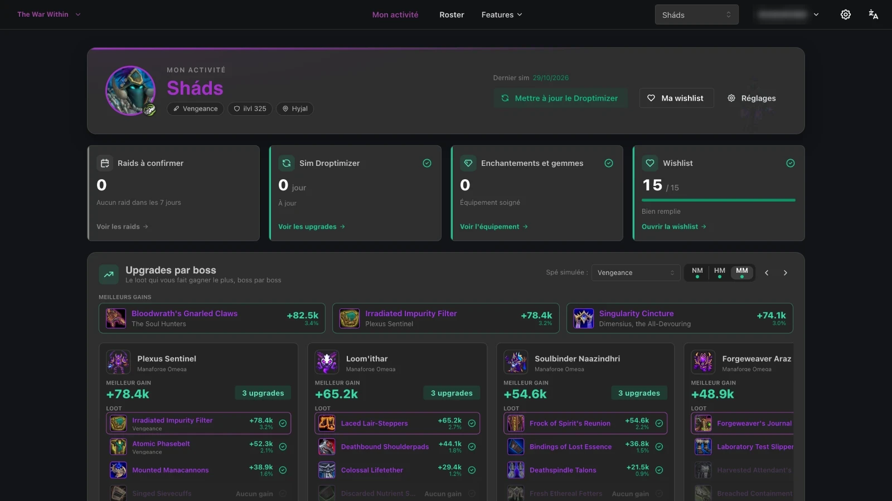
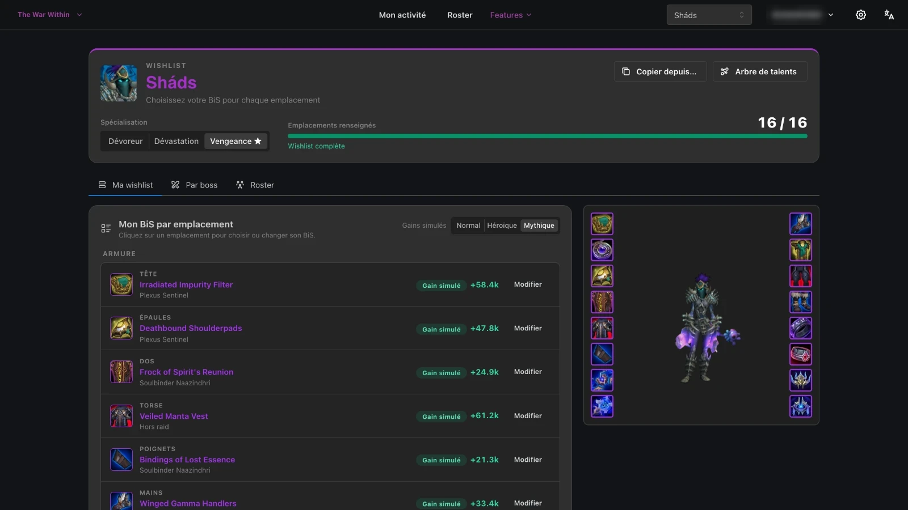
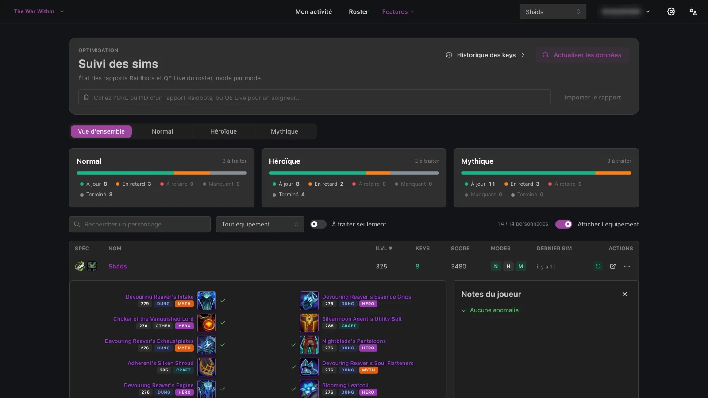
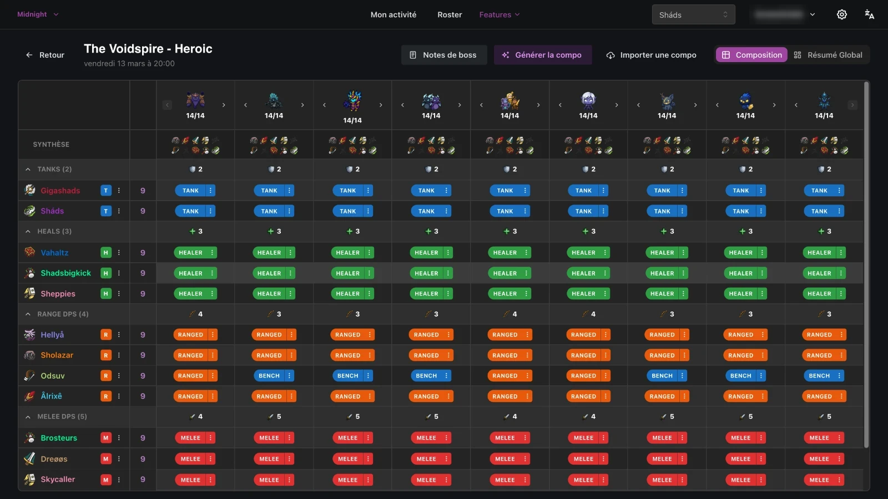
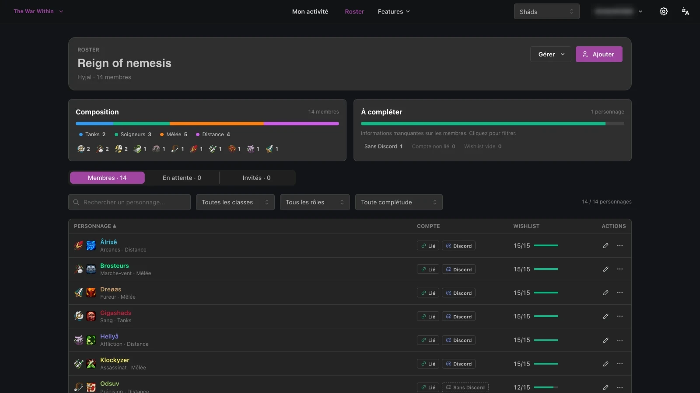

# SimsLens

**Free & open source (MIT) loot optimization and guild management platform for World of Warcraft.**

Players keep wishlists, sign up for raids and follow their character's progress. Officers
manage the roster, raid compositions, loot attribution, attendance and the calendar.
Players sign in with Battle.net and can also sign up for raids from a Discord bot.

Loot votes happen **in game**, in the RCLootCouncil addon. A desktop companion app reads
the addon's data and imports it into SimsLens, which builds on that imported history
instead of running its own vote.

- **Website**: [https://simslens.com](https://simslens.com)
- **Repository**: [https://github.com/GuillaumeBarreau/simslens_app](https://github.com/GuillaumeBarreau/simslens_app)
- **License**: [MIT License](LICENSE) (see [`THIRD_PARTY_NOTICES.md`](THIRD_PARTY_NOTICES.md) for Blizzard/Raidbots assets)

---

## Screenshots

| Raidbots Loot Optimizer (per boss)                   | Player Activity & Boss Upgrades                   |
| ---------------------------------------------------- | ------------------------------------------------- |
|  |  |

| Centralized Wishlists & 3D Preview          | Sim Freshness & Gear Tracking                    |
| ------------------------------------------- | ------------------------------------------------ |
|  |  |

| Shared Raid Calendar & Composition          | Guild Roster & Roles Management         |
| ------------------------------------------- | --------------------------------------- |
|  |  |

---

## Installation

You can install and run SimsLens in three ways:

1. **[Install automatically with an AI Agent](#1-install-with-an-ai-agent-copy-paste-prompt)** (Claude Code, Cursor, Antigravity, Windsurf, Copilot…)
2. **[Standard Local Setup (Development)](#2-standard-local-setup-development)** — Node.js 20+ for the apps, Docker for PostgreSQL & Redis
3. **[Full Docker Compose Setup (Self-Hosting / Production)](#3-full-docker-compose-setup-self-hosting--production)** — Everything containerized

---

### 1. Install with an AI Agent (copy-paste prompt)

Copy one of the prompts below and paste it into your AI coding assistant (**Claude Code**, **Cursor**, **Google Antigravity**, **GitHub Copilot**, **Windsurf**, etc.) from the repository root (or ask it to clone the repo first).

#### Prompt (Français)

```text
Installe et démarre le projet SimsLens en local sur ma machine en suivant exactement ces étapes :

1. Vérifie les prérequis : Node.js >= 20 (`node -v`) et Docker (`docker info`). Si le dépôt n'est pas encore cloné, clone `https://github.com/GuillaumeBarreau/simslens_app.git` et place-toi à la racine.
2. Installe les dépendances npm workspaces : `npm install`.
3. Démarre PostgreSQL (port 5433) et Redis (port 6380) via Docker :
   `docker compose -f docker-compose.local.yml up -d`
4. Si `.env.local` n'existe pas, copie `.env.example` vers `.env.local`, active `ENABLE_DEV_LOGIN=1` dedans (en gardant les valeurs placeholder de `BNET_ID` et `BNET_SECRET` si je n'ai pas encore de clés Battle.net), puis propage la configuration vers tous les workspaces avec :
   `npm run env:local`
5. Génère le client Prisma et applique les migrations sur PostgreSQL :
   `npm run prisma:generate && npm run prisma:migrate:deploy`
6. Initialise les données de référence WoW (classes, spécialisations, raids, boss, objets Raidbots) puis la guilde de démonstration :
   `npm run server:init-data` (ignore l'erreur finale sur les arbres de talents si `BNET_ID` est un placeholder)
   `npm run server:init-fake-data`
7. Démarre l'environnement de développement (`npm run dev`) et confirme-moi que le frontend répond sur http://localhost:5173 et l'API sur http://localhost:5000.
```

#### Prompt (English)

```text
Install and start the SimsLens project locally on my machine by following these exact steps:

1. Check prerequisites: Node.js >= 20 (`node -v`) and Docker (`docker info`). If the repository is not cloned yet, clone `https://github.com/GuillaumeBarreau/simslens_app.git` and `cd` into the root folder.
2. Install npm workspace dependencies: `npm install`.
3. Start PostgreSQL (port 5433) and Redis (port 6380) with Docker:
   `docker compose -f docker-compose.local.yml up -d`
4. If `.env.local` does not exist, copy `.env.example` to `.env.local`, uncomment/enable `ENABLE_DEV_LOGIN=1` (keep the non-empty placeholder values for `BNET_ID` and `BNET_SECRET` if I don't have Battle.net credentials yet), and propagate the environment files to all workspaces:
   `npm run env:local`
5. Generate the Prisma client and apply all database migrations:
   `npm run prisma:generate && npm run prisma:migrate:deploy`
6. Seed the reference data (classes, specs, realms, raids, Raidbots items) and the demo guild:
   `npm run server:init-data` (ignore the final talent tree step failure if `BNET_ID` is a placeholder)
   `npm run server:init-fake-data`
7. Start the development servers (`npm run dev`) and verify that the front end is reachable at http://localhost:5173 and the API at http://localhost:5000.
```

---

### 2. Standard Local Setup (Development)

#### Prerequisites

- [Node.js](https://nodejs.org/) **20 or later** (Vite 7 does not run on Node 18) and npm
- [Docker](https://www.docker.com/products/docker-desktop) with Docker Compose (for PostgreSQL 15 and Redis 7)
- Git

#### Step-by-step

No external account or API key is required to get the API and the front end running locally.

```bash
# 1. Clone and install (npm workspaces: app, app_dashboard, server, server_discord)
git clone https://github.com/GuillaumeBarreau/simslens_app.git simslens
cd simslens
npm install

# 2. Start PostgreSQL (port 5433, user/password `postgres`) and Redis (port 6380)
docker compose -f docker-compose.local.yml up -d

# 3. Create your local configuration
cp .env.example .env.local
```

Edit `.env.local`:

- Uncomment `ENABLE_DEV_LOGIN=1` (last line) to enable the development login.
- **Keep the placeholder values** of `BNET_ID` and `BNET_SECRET` (`votre_bnet_id`,
  `votre_bnet_secret`) if you have no Battle.net client: the server refuses to start when
  `BNET_ID` is empty (`OAuth2Strategy requires a clientID option`).
- Everything else can stay as is.

```bash
# 4. Generate the .env file of each workspace from .env.local
npm run env:local

# 5. Generate Prisma client and apply database migrations
npm run prisma:generate
npm run prisma:migrate:deploy

# 6. Seed reference data (classes, specs, realms, raids, items...)
npm run server:init-data

# 7. Optional: seed a complete test guild (characters, events, wishlists)
npm run server:init-fake-data

# 8. Start everything: front end, admin dashboard, API and Discord bot
npm run dev
```

`server:init-data` downloads the Raidbots item data on first run. Its last steps (talent
trees and talent icons) call the Battle.net API: without real `BNET_*` credentials they
fail and the command exits with an error, after the other reference data has been seeded.

Open **http://localhost:5173**.

| Service         | URL                   |
| --------------- | --------------------- |
| Front end       | http://localhost:5173 |
| Admin dashboard | http://localhost:3001 |
| API             | http://localhost:5000 |
| Discord bot     | port 5001             |
| PostgreSQL      | localhost:5433        |
| Redis           | localhost:6380        |

#### Development login

With `ENABLE_DEV_LOGIN=1`, `GET http://localhost:5000/auth/dev-login?userId=<id>` opens a
session for an existing user without Battle.net (add `&redirect=/some/page` to choose
where you land). The route answers `404` unless `NODE_ENV=development`, `CLIENT_URL`
points to localhost and the request comes from your own machine. Never set this variable
in production.

Changed `.env.local`? Run `npm run env:local` again. Never edit `app/.env`,
`server/.env`, etc. by hand: they are overwritten. Never commit `.env` or `.env.local`.

---

### 3. Full Docker Compose Setup (Self-Hosting / Production)

If you want to run the entire stack inside Docker containers (`nginx`, `client`, `dashboard`, `server`, `discord`, `postgres`, `redis`) using [`docker-compose.yml`](docker-compose.yml):

```bash
# 1. Clone the repository
git clone https://github.com/GuillaumeBarreau/simslens_app.git simslens
cd simslens

# 2. Create and configure the production .env file
cp .env.example .env
```

Edit `.env` with your domain and credentials (`CLIENT_URL`, `SERVER_API_URL`, `VITE_API_BASE_URL`, `SESSION_SECRET`, `BNET_ID`, `BNET_SECRET`, `DISCORD_*`, `CLERK_PUBLISHABLE_KEY`, `VITE_CLERK_PUBLISHABLE_KEY`). Note that `docker-compose.yml` automatically sets internal networking for `DATABASE_URL` (`postgres:5432`) and `REDIS_HOST` (`redis:6379`).

```bash
# 3. Build and start all containers in detached mode
#    (Prisma migrations run automatically on server container startup)
docker compose --env-file .env up -d --build

# 4. Seed reference data (run once on initial deployment)
docker compose --env-file .env run --rm server node ./dist/scripts/initData.js
```

Useful Docker management commands:

```bash
# Check container status and health
docker compose ps

# Follow server logs
docker compose logs -f server

# Rebuild and restart a single service (e.g. client or server)
docker compose --env-file .env build --no-cache client && docker compose --env-file .env up -d client
docker compose --env-file .env build --no-cache server && docker compose --env-file .env up -d server

# Backup PostgreSQL database
docker compose exec -T postgres pg_dump -U postgres droptimizer > ./backup-$(date +%Y%m%d).sql
```

For full production deployment details (Nginx SSL certificates, backups, iCal feed security), see [`docs/DOCKER_DEPLOY.md`](docs/DOCKER_DEPLOY.md).

---

## Optional integrations

| Integration              | Without it                                                         |
| ------------------------ | ------------------------------------------------------------------ |
| Battle.net               | No player login, no character sync; the rest of the API runs       |
| Clerk                    | The admin dashboard (`app_dashboard/`) cannot sign anyone in       |
| Discord bot              | The bot process logs `TokenInvalid`; the API and the front end run |
| Discord OAuth            | Players cannot link their Discord account                          |
| `VITE_DISCORD_CLIENT_ID` | The bot invite link is hidden in the settings page                 |

Use your own applications: the project's production credentials are never shared.

- **Battle.net**: create a client on [develop.battle.net](https://develop.battle.net/),
  add `http://localhost:5000/auth/bnet/callback` as redirect URL, then set `BNET_ID` and
  `BNET_SECRET`. You must comply with the
  [Blizzard Developer API Terms of Use](https://www.blizzard.com/en-us/legal/a2989b50-5f16-43b1-abec-2ae17cc09dd6/blizzard-developer-api-terms-of-use).
- **Clerk** (admin dashboard only): create an application on
  [dashboard.clerk.com](https://dashboard.clerk.com/) and set its publishable key in both
  `CLERK_PUBLISHABLE_KEY` (API) and `VITE_CLERK_PUBLISHABLE_KEY` (dashboard).
- **Discord**: create an application on the
  [Discord Developer Portal](https://discord.com/developers/applications). For the bot,
  set `DISCORD_BOT_TOKEN` and `ENABLE_DISCORD_BOT=true`. For account linking, set
  `DISCORD_CLIENT_ID` and `DISCORD_CLIENT_SECRET` and add
  `http://localhost:5000/auth/discord/callback` as OAuth2 redirect.

Every variable is described in [`.env.example`](.env.example);
[`scripts/env-manager.js`](scripts/env-manager.js) lists which ones each workspace receives.

---

## Monorepo

| Folder            | Role                               | Stack                                                       |
| ----------------- | ---------------------------------- | ----------------------------------------------------------- |
| `app/`            | Front end for players and officers | React, Vite, Mantine 8, TanStack Query, i18next (`fr`/`en`) |
| `app_dashboard/`  | Admin dashboard                    | React, Vite, Tailwind CSS, Clerk                            |
| `server/`         | API and background jobs            | Express 5, Prisma 7 / PostgreSQL, Redis, BullMQ, Joi        |
| `server_discord/` | Discord bot                        | discord.js 14                                               |
| `companion/`      | Desktop companion app              | Tauri, outside the npm workspaces                           |
| `scripts/`        | Tooling (env, docs, permissions)   | Node, no dependencies                                       |
| `deployment/`     | Production deployment              | nginx, shell                                                |

## Commands

```bash
npm run dev                    # front end, dashboard, API and bot together
npm run dev:app                # front end only (5173)
npm run dev:server             # API only (5000)
npm run env:local              # regenerate the workspace .env files from .env.local
npm run prisma:studio          # browse the database
npm run prisma:migrate         # create a migration (migrate dev)
npm run docs                   # regenerate docs/api/reference.md and docs/database/schema.md
npm run format                 # Prettier check
npm run lint                   # ESLint (currently fails on legacy code, see below)
cd app && npm run typecheck    # TypeScript check of the front end
cd server && npx vitest run    # server tests (same command in app/ and app_dashboard/)
```

`npm run lint` and `npm run format` still report issues in legacy code: files you change
must pass both, and the total must not grow.

## Documentation

The documentation is written in French. Start from the index: [`docs/README.md`](docs/README.md).

| Document                                                           | Content                                                     |
| ------------------------------------------------------------------ | ----------------------------------------------------------- |
| [`docs/development.fr.md`](docs/development.fr.md)                 | Environment variables, TypeScript, troubleshooting (French) |
| [`docs/DOCKER_DEPLOY.md`](docs/DOCKER_DEPLOY.md)                   | Full Docker production deployment guide                     |
| [`docs/api/architecture.md`](docs/api/architecture.md)             | API architecture and ongoing migration                      |
| [`docs/api/routes.md`](docs/api/routes.md)                         | Adding an API module                                        |
| [`docs/database/conventions.md`](docs/database/conventions.md)     | Database and migration conventions                          |
| [`docs/frontend/data-fetching.md`](docs/frontend/data-fetching.md) | API calls from the front end                                |
| [`docs/ADMIN_GUIDE.md`](docs/ADMIN_GUIDE.md)                       | Roles and permissions                                       |
| [`docs/TECHNICAL_DEBT.md`](docs/TECHNICAL_DEBT.md)                 | Known issues left as is, and why                            |

## Contributing

See [`CONTRIBUTING.md`](CONTRIBUTING.md). In short: one GitHub issue, one branch, one pull
request; run `npm run verify` before opening it.

### Contributors

SimsLens was developed in a private repository before being open-sourced with a fresh
history. Thanks to everyone who contributed code during that period:

- [Guillaume Barreau](https://github.com/GuillaumeBarreau) — creator and maintainer
- [Xalarian](https://github.com/Xalarian-Dev)
- [Megu](https://github.com/MeguLulu)

## Project tooling

The maintainer uses an internal system of AI agents that audits the code, proposes issues
and implements the approved ones: [`scripts/agents/`](scripts/agents/), the
`agents:*` npm scripts and [`CLAUDE.md`](CLAUDE.md).
It is an internal convention: **you do not need it to contribute**. The only part that
matters to contributors is `npm run verify`, the same full check (Prettier, ESLint, type
checks, tests, build) that runs in CI on every pull request. It is a plain Node script
and does not require any AI agent.

## Blizzard and Battle.net

SimsLens is a non-commercial fan project. It is **not affiliated with or endorsed by
Blizzard Entertainment, Inc.** World of Warcraft, Warcraft, Battle.net and Blizzard
Entertainment are trademarks or registered trademarks of Blizzard Entertainment, Inc. in
the U.S. and/or other countries. Game data comes from the Battle.net API, whose use is
governed by the
[Blizzard Developer API Terms of Use](https://www.blizzard.com/en-us/legal/a2989b50-5f16-43b1-abec-2ae17cc09dd6/blizzard-developer-api-terms-of-use).
